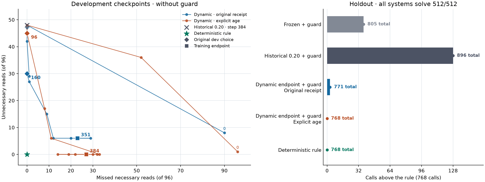

# 动态采样 GRPO 与 Harness 补读校验

**在 512 个留出输入上，显式年龄组的训练终点加 Harness 校验取得 512/512、零无用补读，调用数 768，与确定性规则相同。** 原回执组终点加校验同样取得 512/512，共 771 次调用。相较历史 0.20 臂加校验，两组终点分别省下 125 和 128 次调用。

## 带校验的留出结果

| 部署系统 | 成功 | Harness 补回的必要读取 | 无用补读 | 总调用 |
|---|---:|---:|---:|---:|
| 冻结模型，原回执 + 校验 | 512/512 | 240 | 37 | 805 |
| 历史 0.20 + 校验 | 512/512 | 0 | 128 | 896 |
| 动态采样，原回执终点 + 校验 | 512/512 | 50 | 3 | 771 |
| 动态采样，显式年龄终点 + 校验 | **512/512** | 29 | **0** | **768** |
| 确定性规则 | 512/512 | 0 | 0 | 768 |

调用数从所有策略共有的初始页之后计，最低需要 512 次求均值和 256 次必要补读。对上表中的模型，校验能补回所有漏读，模型发出的多读仍计入成本，所以总调用等于 768 加无用补读数。患者八项都答对且按需调用的 48/64、50/64 是两个终点**无校验**时的结果。加入校验后可由聚合计数推出 61/64、64/64。原回执终点原本有 51 人八项全成功，其中 3 人存在多读，恰好用掉全部 3 次多读。显式年龄终点没有多读，校验补齐了所有失败输入所缺的读取。

左图每个圆点对应一个开发检查点，按训练顺序连线。菱形是原协议选点，方形是训练终点。历史标记取 0.20 臂第 384 步。规则在开发集的漏读和多读均为零。右图是在留出集上开启校验后的调用成本。

## 原协议选点与无校验结果

三栏对应 64 名留出患者的 512 个输入。每位患者有两种分页和四种问法。历史 0.20 臂来自 `914942b`，其开发选点为第 256 步，留出上与第 384 步终点指标一致。工具调用数从共享的初始读取后开始计，包含所有策略发出的动作和校验补读。

| 策略 | 应补读成功 | 漏读 | 充分有下一页成功 | 该栏多读 | 充分已到末页成功 | 该栏多读 | 无校验总成功 | 患者八项都高效 | 校验后成功 | 校验后调用 |
|---|---:|---:|---:|---:|---:|---:|---:|---:|---:|---:|
| 冻结模型，原回执 | 16/256 | 240 | 128/128 | 37 | 128/128 | 0 | 272/512 | 0/64 | 512/512 | 805 |
| 冻结模型，显式年龄 | 0/256 | 256 | 128/128 | 0 | 121/128 | 0 | 249/512 | 0/64 | 505/512 | 768 |
| 历史 0.20，开发选点与第 384 步 | 256/256 | 0 | 128/128 | 128 | 128/128 | 0 | 512/512 | 32/64 | 512/512 | 896 |
| 动态采样，开发选第 160 步 | 256/256 | 0 | 128/128 | 110 | 128/128 | 0 | 512/512 | 32/64 | 512/512 | 878 |
| 动态采样，终点第 351 步 | 206/256 | 50 | 128/128 | 3 | 128/128 | 0 | 462/512 | 48/64 | 512/512 | 771 |
| 动态采样 + 显式年龄，开发选第 96 步 | 256/256 | 0 | 128/128 | 125 | 128/128 | 0 | 512/512 | 32/64 | 512/512 | 893 |
| 动态采样 + 显式年龄，终点第 384 步 | 227/256 | 29 | 128/128 | 0 | 128/128 | 0 | 483/512 | 50/64 | 512/512 | 768 |
| 确定性规则 | 256/256 | 0 | 128/128 | 0 | 128/128 | 0 | 512/512 | 64/64 | 512/512 | 768 |

按原协议的开发选点，原回执组在留出上保持零漏读，把多读从 128 次降到 110 次，减少 14.1%。显式年龄组同样零漏读，多读 125 次。三者在患者八项都高效上是同一批 32/64 人。两个训练终点在无校验下分别漏读 50 和 29 次。冻结模型只加年龄字段时，必要补读成功从 16/256 降到 0/256，另有 7 次算子错误。原协议选点、冻结诊断和不等长的训练终点合在一起，尚不足以支持显式年龄字段有稳定增益。患者级配对结果与置信区间见 [RESULT.json](RESULT.json)。

## 按部署指标做事后选点

用带校验成功数优先、总调用数次之、步数较早优先，对已有开发检查点重排。两臂所有训练后开发检查点在校验下均为 192/192，规则最低调用为 288。此时总调用就是 288 加多读数。

| 训练臂 | 事后开发选点 | 带校验成功 | 校验后调用 | 训练终点的开发表现 |
|---|---:|---:|---:|---|
| 原回执 | 256 | 192/192 | 294 | 第 351 步，192/192、294 次调用 |
| 显式年龄 | 192 | 192/192 | 288 | 第 384 步，192/192、288 次调用 |

第 256 和 192 步只有开发结果。留出测试仍报告原协议锁定的检查点和预先规定的训练终点。两个训练终点在事后部署指标下都与各自重新选中的开发点持平。显式年龄组终点漏读在开发集为 27 次，在留出为 29 次。原回执组在开发集从早期零漏读、48 次多读，走到终点 23 次漏读、6 次多读。轨迹表明两种错误间存在取舍。1:2:1 配额提高了充分有下一页的样本权重，这可能推动策略减少读取，独立作用仍需消融验证。

## 协议与解读范围

两组复用原 64/32/64 患者分区、四动作接口、0.20 无用补读成本、语言层 q/v rank-8 LoRA、学习率 2e−5 和 KL 0.02。每个更新从 8 次同题在线采样的组中筛出奖励有差异的组，按应补读、充分有下一页、充分已到末页收 1、2、1 组。每次尝试至多采 48 组，至多发起 512 次尝试。仅 GPU 7 将当前回执已有的最早年龄单独列出。开发集按总成功数、无用补读少、较早步数选点，两组锁定检查点后才读取留出。

动态采样借鉴 DAPO 的组过滤。这里按数值奖励过滤，成功直接计算和成功多读也构成不同奖励。相同奖励组的任务优势为零，原 GRPO 的 KL 项仍可能有梯度。历史对照同时涉及难例占比、组大小、过滤和实际采样量的变化。留出面板此前已用于诊断，本次是单种子复验。[DAPO 动态采样](https://arxiv.org/html/2503.14476#S3.SS2)

旧训练分布中，有下一页的候选里约三分之二确实要补读。比较在这个子集内总读与从不读的两个固定策略，损失一次必要补读的代价为 1.96，切换固定策略偏好要求无用补读惩罚超过 3.92。能区分证据状态的策略在 0.20 下就有更高奖励。例如充分时直接算得 0.98，无用补读得 0.78。这解释了为什么改成本和让动作真正进入采样是两件事。

## 面试讲法

冻结 7B 模型只做对了 16/256 次必要补读。早期 GRPO 将必要补读提高到 256/256，却对所有仍有下一页的充分输入继续读。随后做了两项诊断，固定策略的奖励比较解释了为什么十倍惩罚仍不足以改变其偏好，采样日志显示有任务优势的组在训练后期变少。加入难例配额和动态采样后，训练终点多读降到 0–3 次，同时漏读回升。最后把本任务由工具契约确定的证据完整性交给 Harness 校验，策略侧减少多余调用，两者组合在这批输入上达到或接近确定性规则的调用成本。

四个动作的奖励可以直接枚举，用 $\nabla_\theta \sum_a \pi_\theta(a\mid x)r(x,a)$ 优化原期望奖励，避免动作采样方差。这里保留在线采样是为了练通可拓展到无法完整枚举的输出空间的训练流程。组过滤与分层配额会改变实际训练分布，直接枚举原期望奖励对应另一个目标。自由生成场景中的收益要由该场景的实验来验证。

## 每段采样明细

按开发评估间隔统计当段增量。各分层显示「含差异组 / 候选组（参与更新组）」。每行的开发集计数对应该段终点。

### 原回执

| 步数 | 开发成功 | 多读 | 应补读 | 充分有下一页 | 充分已到末页 |
|---:|---:|---:|---:|---:|---:|
| 32 | 192/192 | 48 | 56/96（32） | 102/136（64） | 55/88（32） |
| 64 | 192/192 | 47 | 40/440（32） | 82/468（64） | 51/116（32） |
| 96 | 192/192 | 42 | 41/487（32） | 89/369（64） | 50/272（32） |
| 128 | 191/192 | 29 | 44/608（32） | 96/328（64） | 42/512（32） |
| 160 | 192/192 | 30 | 50/738（32） | 113/288（64） | 40/750（32） |
| 192 | 191/192 | 27 | 49/898（32） | 131/294（64） | 41/984（32） |
| 224 | 183/192 | 15 | 42/629（32） | 117/221（64） | 43/646（32） |
| 256 | 180/192 | 6 | 44/1155（32） | 166/307（64） | 48/1058（32） |
| 288 | 172/192 | 6 | 40/611（32） | 120/213（64） | 38/760（32） |
| 320 | 163/192 | 6 | 52/1497（32） | 203/469（64） | 51/1434（32） |
| 351 | 169/192 | 6 | 40/358（31） | 98/178（62） | 41/600（31） |

### 显式年龄

| 步数 | 开发成功 | 多读 | 应补读 | 充分有下一页 | 充分已到末页 |
|---:|---:|---:|---:|---:|---:|
| 32 | 140/192 | 36 | 56/64（32） | 121/128（64） | 53/72（32） |
| 64 | 192/192 | 48 | 43/161（32） | 90/359（64） | 64/72（32） |
| 96 | 192/192 | 45 | 41/422（32） | 98/260（64） | 58/94（32） |
| 128 | 184/192 | 17 | 39/623（32） | 100/183（64） | 48/242（32） |
| 160 | 181/192 | 6 | 42/479（32） | 136/155（64） | 41/518（32） |
| 192 | 159/192 | 0 | 39/1259（32） | 183/289（64） | 53/1028（32） |
| 224 | 170/192 | 0 | 51/733（32） | 131/453（64） | 46/1022（32） |
| 256 | 162/192 | 0 | 38/738（32） | 108/326（64） | 48/488（32） |
| 288 | 160/192 | 0 | 43/640（32） | 94/310（64） | 42/626（32） |
| 320 | 173/192 | 0 | 43/598（32） | 105/396（64） | 42/630（32） |
| 352 | 178/192 | 0 | 42/641（32） | 117/383（64） | 46/816（32） |
| 384 | 165/192 | 0 | 45/650（32） | 107/440（64） | 42/710（32） |

## 采样成本与运行核验

| 训练臂 | 尝试次数 | 优化步 | 含奖励差异的候选组 | 在线采样动作 |
|---|---:|---:|---:|---:|
| 历史 0.20 | 384 | 384 | 170/1,536 | 6,144 |
| 动态采样，原回执 | 512 | 351 | 2,315/18,008 | 144,064 |
| 动态采样，显式年龄 | 509 | 384 | 2,495/17,008 | 136,064 |

两组实际使用的 1,404 和 1,536 个训练组均含奖励差异，采样量约为历史臂的 23.4 倍和 22.1 倍。原回执组达到预设 512 次尝试上限。显式年龄组在第 509 次尝试完成计划的 384 个更新。原回执组末块「充分仍有下一页」的候选中 98/178 含差异，「充分已到末页」仅 41/600。显式年龄组末块对应 107/440 和 42/710。配额要求每个实际更新覆盖三种状态，所以有差异的难例仍在时，其他分层的低命中也会使整次尝试跳过。

两进程退出码均为 0，准备到结束共 1 小时 44 分 3 秒。GPU 6、7 的 PyTorch 保留显存峰值为 30,666 和 31,560 MiB。预检首次发现仅算分支前缀会改变概率，两进程在更新前退出。正式运行按完整合法计划计算，每臂抽查 8 个输入的单输入路径与旧实现一致。混合长度批量训练概率的最大绝对差分别为 0.0319 和 0.0273，抽查中贪心动作均未改变，开发和留出继续使用原单输入打分。两组选点适配器保存、重载后在验证输入上得到相同分数。新旧留出使用同一病例文件。患者级配对汇总由服务器私有数据计算，公开文件中只包含聚合。
