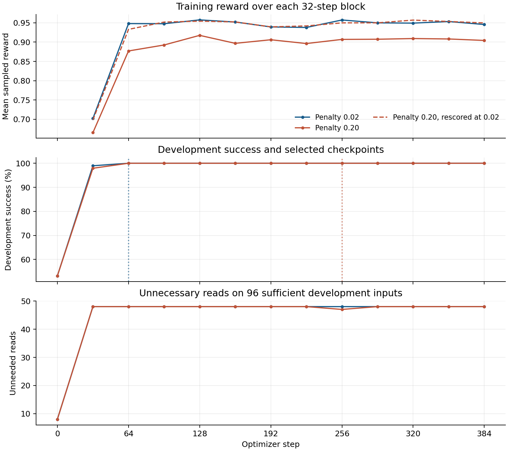

# GRPO 无用补读成本消融

复用 a5d520a 的 VitalDB 面板、患者分区、四种动作和执行器。两臂使用相同种子与训练预算，各 384 步、6,144 个在线采样动作，LR 2e−5，语言层 LoRA rank 8；无 JS 附加项。0.02 臂使用原奖励；0.20 臂只提高成功且无用补读的代价，由 0.96 改到 0.78。成功但必要补读仍为 0.96，成功直接计算仍为 0.98，失败仍为 −1。

开发评估每 32 步一次，按总成功数优先、无用补读次之选检查点。两个检查点都锁定后才评留出。此次复用了已经分析过的旧留出病例和表述，用于同面板受控对照。每位留出患者依然对应八个相关输入，共 64 人、512 输入。

## 留出结果

| 策略 | 应补读成功 | 应补读却提前结束 | 证据充分成功 | 无用补读 | 无校验总成功 | 患者八项都高效 | 启用校验成功 | 启用校验后总调用 |
|---|---:|---:|---:|---:|---:|---:|---:|---:|
| 冻结模型 | 16/256 | 240 | 256/256 | 37 | 272/512 | 0/64 | 512/512 | 805 |
| 原奖励，开发选第 64 步 | 256/256 | 0 | 256/256 | 132 | 512/512 | 28/64 | 512/512 | 900 |
| 高惩罚，开发选第 256 步 | 256/256 | 0 | 256/256 | 128 | 512/512 | 32/64 | 512/512 | 896 |
| 原奖励，固定第 384 步 | 256/256 | 0 | 256/256 | 128 | 512/512 | 32/64 | 512/512 | 896 |
| 高惩罚，固定第 384 步 | 256/256 | 0 | 256/256 | 128 | 512/512 | 32/64 | 512/512 | 896 |
| 确定性规则 | 256/256 | 0 | 256/256 | 0 | 512/512 | 64/64 | 512/512 | 768 |

工具调用去除所有策略共享的初始页；保留模型主动补读，再加执行器补读。八项都高效要求同患者的两种分页、四种问法全部正确，并在证据充分时不多读。

- 开发选点，高惩罚相对原奖励的患者八项都高效改对 4、改错 0 名患者，净差 +6.25 个百分点，患者级配对 bootstrap 95% 区间 [+1.56, +12.50]，配对精确检验 p=0.125。
- 固定第 384 步，高惩罚相对原奖励的患者八项都高效改对 0、改错 0 名患者，净差 +0.00 个百分点，患者级配对 bootstrap 95% 区间 [+0.00, +0.00]，配对精确检验 p=1。
- 原奖励组开发选第 64 步，383/384 个非零梯度步，230/1536 个有任务优势的采样组。
- 高惩罚组开发选第 256 步，383/384 个非零梯度步，170/1536 个有任务优势的采样组。

图中训练奖励为每 32 步的在线样本均值；虚线对高惩罚组的动作按原奖励重算，以便跨臂比较。开发指标共有 13 个点，竖线为选择的检查点。

总历时约 26 分 59 秒，GPU 6、7 的 PyTorch 保留峰值为 19.99、19.99 GiB。代码、报告与聚合指标公开，病例、逐例轨迹和适配器保留在私有目录。

## 结论与分页诊断

本轮两臂在已分析的同一留出上均把必要补读从冻结模型的 16/256 提到 256/256，提前结束从 240 次降到 0。提高无用补读惩罚后，开发选点少多读 4 次，但仅涉及 4 位患者，配对精确检验 p=0.125。按预先固定的第 384 步比较，两臂共计调用数、正确数和无用补读次数均相同，均多读 128 次。

事后按充分页的 has_more 分组，两个终点在仍有下一页的 32 个病例上对四种问法全部多读，在已到末页的另外 32 例没有多读。结合 256 次必要补读，所观察到的决策与“有下一页就读”相符。校验能补救漏读，仍会保留模型主动发出的多读，所以在这批样例上规则与两个终点都取得 512/512，而规则少 128 次调用。该结果提供强证据用于讲述漏读和多读的权衡，尚未验证未用过的患者队列或跨 FHIR 工作流的泛化。

最后一个 32 步块内，原奖励与高惩罚分别只有 12/128 和 7/128 个采样组含不同奖励。这与后期决策变化减慢一致，不能靠这一项断定唯一原因。两臂只在无用补读代价上不同。与历史 64 步实验的对比同时涉及训练长度与学习率，单项作用未分离。
## 面试追问

- **GRPO 的优势。** 同一输入从当前策略采样 4 个动作，执行后对奖励组内去均值。组内全同奖励时，任务优势全部为零。这里保留原奖励单位，所以高低成本的差异会直接反映在优势幅度。相对采用学习价值函数的 PPO，组均值提供基线，省去了价值网络。[DeepSeekMath](https://arxiv.org/html/2402.03300#S4.SS1)
- **KL 与 clip。** 关闭 LoRA 后的基座是 KL 参考。每批只更新一次，动作概率分母是当前前向的停止梯度副本，前向 ratio 为 1。分子的梯度仍在，clip 在这个配置里没有实际裁剪。
- **LoRA 参数。** rank 8 加在语言模型每层的 q/v 投影，约 252 万可训练参数量级。用低秩适配便于在同一张卡上共享训练与采样显存。基座和视觉编码器冻结。本轮没有 rank 或投影层的消融。
- **受限动作概率。** 预先把四种合法 JSON 计划编码成 token 序列；共享前缀处只对合法分支做 softmax，逐分支累加 log probability，再归一化得到四动作分布。只有一个合法后续的 token 概率为 1。自由 JSON 预检存在大量非法输出，所以先控制格式来测策略选择。
- **奖励与工具代价。** 原奖励把遗漏必要记录定为失败，代价远大于一次多读。因此多读可以换来较多成功。用“奖励所体现的精度与成本权衡”描述最扎实。新消融只改变成功时无用补读的代价。
- **规则与 RL。** 模型根据问题与当前回执选择短计划。分页完整性可以由工具契约确定，执行器可以直接保证。这里的 RL 是在真实回执上优化一次短计划决策。FHIR 多轮工作流另有独立验证范围，不能把本实验分数转述为完整端到端 FHIR 成功率。
- **患者与问法。** 同一患者的页大小、题面派生和回执相关，同一患者的一切变体在同一数据分区。问法再单独切分，用于测新表达。旧面板已公开分析，本轮结果用于同面板奖励对照。
